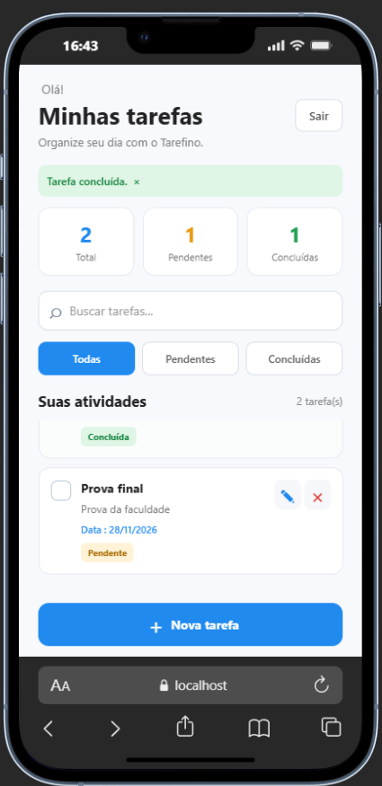
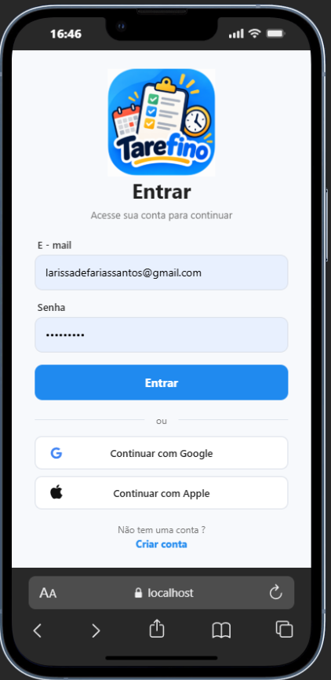

# Tarefino

Aplicativo de gerenciamento de tarefas feito com **Expo (React Native)** e **Firebase**. Funciona na web, no Android e no iOS a partir do mesmo código.

Cada usuário cria sua conta, confirma o e-mail e passa a gerenciar apenas as próprias tarefas.

## Funcionalidades

**Autenticação**
- Cadastro com nome, e-mail, telefone e senha forte (mínimo de 8 caracteres, maiúscula, minúscula, número e caractere especial)
- Verificação de e-mail obrigatória antes do primeiro acesso
- Reenvio do link de verificação pela tela de login
- Bloqueio de telefone já cadastrado
- Logout

**Tarefas**
- Criar, editar, concluir/reabrir e excluir tarefas (com confirmação antes de excluir)
- Título, descrição (até 500 caracteres) e data de vencimento opcional no formato `DD/MM/AAAA`, com máscara automática e validação de datas reais
- Atualização em tempo real via Firestore
- Busca por título, descrição ou data
- Filtros: Todas, Pendentes e Concluídas
- Contadores de total, pendentes e concluídas

> Os botões "Continuar com Google" e "Continuar com Apple" ainda são apenas ilustrativos e não realizam login.

## Capturas de tela

| Tela inicial | Login |
| :---: | :---: |
|  |  |

## Tecnologias

- [Expo](https://expo.dev) SDK 57 com [Expo Router](https://docs.expo.dev/router/introduction) (rotas baseadas em arquivos)
- [React Native](https://reactnative.dev) 0.86 e React 19
- [TypeScript](https://www.typescriptlang.org)
- [Firebase](https://firebase.google.com): Authentication e Cloud Firestore

## Estrutura do projeto

```
src/
├── app/
│   ├── _layout.tsx      # Navegação raiz (Stack)
│   ├── index.tsx        # Login
│   ├── cadastro.tsx     # Criação de conta
│   ├── tarefas.tsx      # Lista e CRUD de tarefas
│   └── explore.tsx      # Tela de exemplo do template Expo
├── components/          # Componentes reutilizáveis
├── constants/           # Tema
├── hooks/               # Hooks de tema e esquema de cores
└── firebaseConfig.ts    # Inicialização do Firebase
```

## Como rodar

### Pré-requisitos

- [Node.js](https://nodejs.org) (versão LTS)
- Um projeto no [Firebase Console](https://console.firebase.google.com)

### 1. Clonar e instalar

```bash
git clone https://github.com/larissadefarias/Tarefino-APP.git
cd Tarefino-APP
npm install
```

### 2. Configurar o Firebase

1. No Firebase Console, crie um projeto e adicione um **app Web**.
2. Em **Authentication → Sign-in method**, ative **E-mail/senha**.
3. Em **Firestore Database**, crie um banco de dados.
4. Copie as credenciais do app Web para `src/firebaseConfig.ts`:

```ts
const firebaseConfig = {
    apiKey: "...",
    authDomain: "...",
    projectId: "...",
    storageBucket: "...",
    messagingSenderId: "...",
    appId: "..."
};
```

### 3. Regras do Firestore

As tarefas pertencem a um usuário pelo campo `uid`. Use regras que impeçam o acesso a tarefas de outras pessoas, por exemplo:

```
rules_version = '2';
service cloud.firestore {
  match /databases/{database}/documents {
    match /tarefas/{tarefaId} {
      allow read, update, delete: if request.auth != null
                                  && resource.data.uid == request.auth.uid;
      allow create: if request.auth != null
                    && request.resource.data.uid == request.auth.uid;
    }
  }
}
```

### 4. Iniciar o app

```bash
npx expo start
```

No terminal, escolha onde abrir: navegador (`w`), emulador Android (`a`), simulador iOS (`i`) ou o app [Expo Go](https://expo.dev/go) no celular.

## Scripts

| Comando | O que faz |
| --- | --- |
| `npm start` | Inicia o servidor de desenvolvimento |
| `npm run web` | Abre o app no navegador |
| `npm run android` | Abre no Android |
| `npm run ios` | Abre no iOS |
| `npm run lint` | Executa o linter |

## Modelo de dados

**Coleção `usuarios`**

| Campo | Tipo |
| --- | --- |
| `uid` | string |
| `nome` | string |
| `email` | string |
| `telefone` | string (somente dígitos) |
| `criadoEm` | data |

**Coleção `tarefas`**

| Campo | Tipo |
| --- | --- |
| `uid` | string (dono da tarefa) |
| `titulo` | string |
| `descricao` | string |
| `dataVencimento` | string (`DD/MM/AAAA`, opcional) |
| `concluida` | boolean |
| `criadoEm` | timestamp |
| `atualizadoEm` | timestamp |

## Equipe

Projeto desenvolvido na **UNISUAM**, sob a liderança do professor **André Zeferino**, em conjunto com a turma, que construiu o aplicativo ao longo do curso.

| Papel | Nome |
| --- | --- |
| Professor orientador | André Zeferino |
| Instituição | UNISUAM |

## Licença

Consulte o arquivo [LICENSE](./LICENSE).
